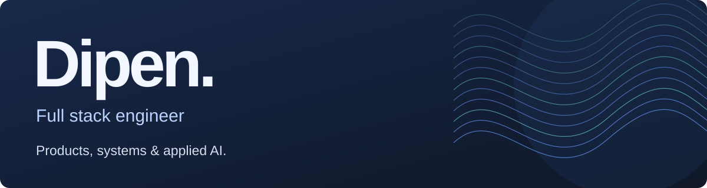
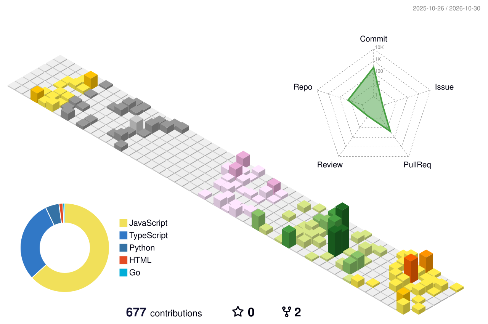

  <a href="mailto:dipenntalreja@gmail.com"><strong>Email me</strong></a>
  &nbsp; / &nbsp;
  <a href="https://github.com/Dipen-t?tab=repositories">Browse my work</a>

I turn complex workflows into software people can actually use — from live collaboration and multi-tenant platforms to voice assistants and developer tools.

I enjoy the whole process: making sense of a vague idea, designing the system, and following it through to a working product.

## Selected work

### [LeadFlow](https://github.com/Dipen-t/LeadFlow)
A mortgage brokerage CRM built end to end, with isolated tenants, a live lead pipeline, client portals, and background document workflows.

React / TypeScript / Node.js / MongoDB / Redis / Socket.IO

[Try the demo](https://lead-flow-umber.vercel.app) &nbsp; · &nbsp; [Read the engineering breakdown](https://github.com/Dipen-t/LeadFlow#architecture-overview)

### [VoiceOps](https://github.com/Dipen-t/voice-ops)
A Hinglish voice assistant prototype with streaming speech and source-backed retrieval over a fictional insurance FAQ. Includes a recorded-incident investigation mode with scoped MCP tools.

TypeScript / Fastify / PostgreSQL / pgvector / Sarvam / MCP

### [EvolveKit](https://github.com/Dipen-t/living-ai)
A foundation for changing an application's behavior through validated proposals. Preview changes, approve a specific revision, publish it, and roll back — with registered capabilities and an audit trail.

TypeScript / React / Fastify / Prisma / PostgreSQL

### [Checkpoint](https://github.com/Dipen-t/checkpoint)
An experimental tool that gives coding agents project rules and architectural memory. Local retrieval, human decision points, and Git diff checks help keep changes within scope.

TypeScript / CLI / BM25 / Git

<strong>More things I've built</strong>

- **[Saathi](https://github.com/Dipen-t/Saathi)** — local discovery, real-time conversations, and plans that bring people together.
- **[Tracker](https://github.com/Dipen-t/Tracker)** — task management, reliable timers, productivity charts, and AI-assisted task creation. [Demo](https://tracker-chi-blue.vercel.app/)
- **[Dhanlaxmi Catering](https://github.com/Dipen-t/dhanlaxmi-ui)** — a responsive catering website with scroll-driven compositions and accessible motion.

## Beyond public repositories

My professional work includes offline municipal surveys across **150,000+ records and 50+ wards**, multi-tenant platforms for **10+ organizations**, browser automation for **100+ colleges**, and GPS-linked construction operations.

Client code stays private. I'm happy to talk through the architecture, trade-offs, and lessons.

## What I work with

**Interfaces** &nbsp; React, Next.js, TypeScript, Tailwind CSS  
**Systems** &nbsp; Node.js, Fastify, Express, PHP, WebSockets, Socket.IO  
**Data** &nbsp; PostgreSQL, MongoDB, MySQL, Redis, BullMQ, Prisma, Drizzle, Supabase  
**AI & automation** &nbsp; RAG, pgvector, MCP, Playwright  
**Infrastructure & maps** &nbsp; Docker, Linux, Git, QGIS, Mapbox

## My contribution skyline

<picture>
  <source media="(prefers-color-scheme: dark)" srcset="./profile-3d-contrib/profile-night-view.svg" />
  <source media="(prefers-color-scheme: light)" srcset="./profile-3d-contrib/profile-season-animate.svg" />
  
</picture>

Refreshes daily with <a href="https://github.com/yoshi389111/github-profile-3d-contrib">GitHub Profile 3D Contrib</a>.

---

🏆 **B.K. Birla College Hackathon winner** · AI-powered summarization tool

Got a product idea or a difficult engineering problem? [Let's talk.](mailto:dipenntalreja@gmail.com)
