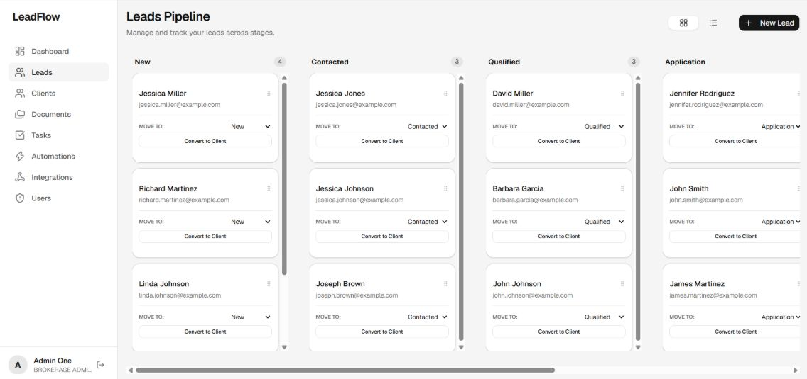
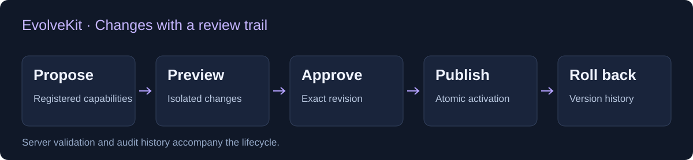
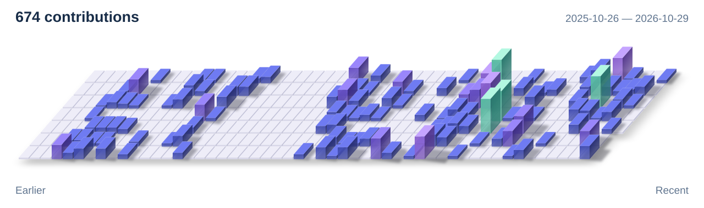

  <a href="mailto:dipenntalreja@gmail.com"><strong>Get in touch</strong></a>
  &nbsp; / &nbsp;
  <a href="#selected-work">Selected work</a>
  &nbsp; / &nbsp;
  <a href="https://github.com/Dipen-t?tab=repositories">All repositories</a>

**I'm Dipen Talreja, a full-stack engineer building real-time SaaS products and applied AI tools.** I work across interfaces, APIs, data, and deployment, with a particular interest in tenant isolation, reliable background work, and AI systems with clear boundaries.

## Selected work

I built the four projects below independently.

### [LeadFlow](https://github.com/Dipen-t/LeadFlow) · Live demo

A CRM for mortgage brokerages, from lead intake to client onboarding.

**My work:** frontend, backend, database integration, live updates, background workers, and deployment.  
**Engineering detail:** optimistic pipeline updates reconcile server-side version conflicts; Socket.IO keeps connected clients synchronized.

React · TypeScript · Node.js · MongoDB · Redis · BullMQ · Socket.IO

[Try the demo](https://lead-flow-umber.vercel.app) · [Architecture and setup](https://github.com/Dipen-t/LeadFlow#architecture-overview)

### [VoiceOps](https://github.com/Dipen-t/voice-ops) · Local prototype

A Hinglish voice assistant that retrieves answers from a fictional insurance FAQ and cites its sources.

**My work:** the voice interface, streaming speech pipeline, retrieval, and recorded-incident investigation mode.  
**Engineering detail:** PostgreSQL/pgvector retrieval supports sourced answers; scoped, read-only MCP tools support incident investigation.

TypeScript · React · Fastify · PostgreSQL/pgvector · Sarvam · MCP

[Setup and current limits](https://github.com/Dipen-t/voice-ops#local-setup) · [Voice assistant status](https://github.com/Dipen-t/voice-ops/blob/main/docs/hindi-assistant-status.md)

### [EvolveKit](https://github.com/Dipen-t/living-ai) · Working local demo

A runtime foundation for proposing changes to an application's registered capabilities, with review before activation.

**My work:** the TypeScript capability model, React adapter, proposal lifecycle, API, persistence, and planner integrations.  
**Engineering detail:** server validation, exact-revision approval, atomic publication, and rollback keep changes traceable.

TypeScript · React · Fastify · Prisma · PostgreSQL

[Run the demo and inspect the design](https://github.com/Dipen-t/living-ai#run-locally)

### [Checkpoint](https://github.com/Dipen-t/checkpoint) · Experimental developer tool

Architectural guardrails and local decision memory for AI coding agents.

**My work:** the rule-retrieval, decision, and verification workflow.  
**Engineering detail:** local BM25 retrieval surfaces relevant constraints; Git diff checks compare actual changes with the agent's claims.

TypeScript · CLI · BM25 · Git

[Quickstart and limitations](https://github.com/Dipen-t/checkpoint#-30-second-quickstart)

<strong>More projects</strong>

- **[Saathi](https://github.com/Dipen-t/Saathi)** — nearby discovery, real-time conversations, and plans that bring people together.
- **[Tracker](https://github.com/Dipen-t/Tracker)** — task management, server-side timers, productivity charts, and AI-assisted task creation. [Demo](https://tracker-chi-blue.vercel.app/)
- **[Dhanlaxmi Catering](https://github.com/Dipen-t/dhanlaxmi-ui)** — a responsive catering website with scroll-driven compositions and accessible motion.

## Production experience

Beyond these public projects, my professional work includes:

- **Municipal field operations:** offline surveys, GIS mapping, and synchronization across **150,000+ records and 50+ wards**.
- **Multi-tenant platforms:** organization isolation, review workflows, and access control for **10+ organizations**.
- **Browser automation:** structured extraction from dynamic websites for **100+ colleges**.
- **Construction operations:** GPS-linked check-ins, material approvals, and photo-verified dispatch.

Client code is private; I can discuss the engineering decisions and trade-offs.

## Core toolkit

**Frontend:** TypeScript, React, Next.js, Tailwind CSS  
**Backend & data:** Node.js, Fastify, PostgreSQL, MongoDB, Redis  
**Systems & AI:** WebSockets, BullMQ, RAG, pgvector, MCP  
**Delivery & automation:** Docker, Git, Playwright

## My contribution skyline

<picture>
  <source media="(prefers-color-scheme: dark)" srcset="./assets/contributions-dark-depth.svg" />
  <source media="(prefers-color-scheme: light)" srcset="./assets/contributions-light-depth.svg" />
  
</picture>

Refreshes daily with <a href="https://github.com/yoshi389111/github-profile-3d-contrib">GitHub Profile 3D Contrib</a>.

---

🏆 **B.K. Birla College Hackathon winner** · AI-powered summarization tool

Got a product idea or a difficult engineering problem? [Let's talk.](mailto:dipenntalreja@gmail.com)
