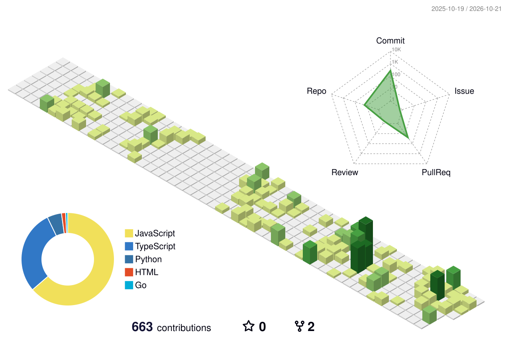

  

  <a href="#selected-projects">Projects</a> ·
  <a href="#engineering-in-the-real-world">Experience</a> ·
  <a href="#toolbox">Toolbox</a> ·
  <a href="mailto:dipenntalreja@gmail.com">Get in touch</a>

# Hey, I'm Dipen 👋

I build full-stack products for messy, real-world problems: real-time collaboration, multi-tenant workflows, offline field operations, and AI tools with clear boundaries.

I like owning the whole loop — understanding what people need, designing the system, building it, and learning from what happens when people use it.

**Currently exploring:** voice interfaces with retrieval, controlled AI-driven application changes, and guardrails for coding agents.

## Selected projects

<table>
<tr>
<td width="50%" valign="top">

### 01 / LeadFlow
**From first lead to client onboarding.**

A multi-tenant CRM for mortgage brokerages: configurable pipelines, optimistic drag-and-drop, role-based portals, live updates, and background document workflows.

`React` `TypeScript` `Node.js` `MongoDB` `Redis` `Socket.IO`

[Explore code →](https://github.com/Dipen-t/LeadFlow) · [Live demo ↗](https://lead-flow-umber.vercel.app)

</td>
<td width="50%" valign="top">

### 02 / VoiceOps
**Ask in Hinglish. Get a sourced answer.**

A voice assistant prototype using a fictional insurance FAQ, retrieval with PostgreSQL/pgvector, and streaming speech. Also includes a recorded-incident investigation mode.

`TypeScript` `Fastify` `React` `pgvector` `MCP` `Sarvam`

[Explore code →](https://github.com/Dipen-t/voice-ops)

</td>
</tr>
<tr>
<td width="50%" valign="top">

### 03 / EvolveKit
**Propose. Preview. Approve. Publish. Roll back.**

A runtime evolution foundation for existing apps. AI proposes changes within registered capabilities; server validation, exact-revision approval, and version history govern activation.

`TypeScript` `React` `Fastify` `Prisma` `PostgreSQL`

[Explore code →](https://github.com/Dipen-t/living-ai)

</td>
<td width="50%" valign="top">

### 04 / Checkpoint
**Give coding agents architectural memory.**

An experimental developer tool for enforcing project constraints, remembering engineering decisions, and checking actual diffs. Built around local rule retrieval and human decision points.

`TypeScript` `CLI` `BM25` `Git`

[Explore code →](https://github.com/Dipen-t/checkpoint)

</td>
</tr>
</table>

**Also on the workbench**

- **[Saathi](https://github.com/Dipen-t/Saathi)** — a local social platform for discovering nearby people, conversations, plans, and meetups. Next.js, Supabase Realtime, and Drizzle.
- **[Tracker](https://github.com/Dipen-t/Tracker)** — task and time tracking with server-side timers, productivity charts, CSV export, and AI-assisted task creation. [Live demo ↗](https://tracker-chi-blue.vercel.app/)
- **[Dhanlaxmi Catering](https://github.com/Dipen-t/dhanlaxmi-ui)** — a responsive, motion-rich website with scroll-driven compositions, accessible controls, and reduced-motion support.

## Engineering in the real world

Most of my professional work is private. Here is the engineering context I can share:

| System | Scale & engineering focus |
| :--- | :--- |
| **Municipal GIS & field operations** | **150,000+ consumer records · 50+ wards.** Offline data collection, GPS/GIS mapping, photos, signatures, and synchronization. |
| **Education & career platform** | **10+ organizations · 7+ staff roles.** Tenant isolation, RBAC, review workflows, resume builders, and PDF generation. |
| **Browser automation** | **100+ colleges.** Playwright pipelines for dynamically rendered sites, reusable extraction, and proxy-based workflows. |
| **Construction operations** | **5+ operational roles.** GPS-linked camera check-ins, material approvals, and photo-verified dispatch. |

The questions I bring to a project: **What happens when the network drops? Can tenants see each other's data? What survives a partial failure? Can someone use this without a walkthrough?**

## Toolbox

| Area | Tools I work with |
| :--- | :--- |
| **Languages** | TypeScript · JavaScript · PHP · SQL |
| **Interfaces** | React · Next.js · Tailwind CSS · Vite |
| **APIs & live systems** | Node.js · Fastify · Express · WebSockets · Socket.IO · Supabase Realtime |
| **Data & background work** | PostgreSQL · MongoDB · MySQL · Redis · BullMQ · Prisma · Drizzle · Supabase |
| **AI & automation** | Retrieval/RAG · pgvector · MCP · Playwright · Browser automation |
| **Infrastructure & GIS** | Docker · Linux · Git · GitHub Actions · QGIS · Mapbox |

## A year of building, in 3D

<picture>
  <source media="(prefers-color-scheme: dark)" srcset="./profile-3d-contrib/profile-night-green.svg" />
  <source media="(prefers-color-scheme: light)" srcset="./profile-3d-contrib/profile-green-animate.svg" />
  
</picture>

Generated daily from GitHub contribution data with <a href="https://github.com/yoshi389111/github-profile-3d-contrib">GitHub Profile 3D Contrib</a>. <a href="https://github.com/Dipen-t/Dipen-t/actions/workflows/profile-3d.yml">Generation status ↗</a>

---

**B.K. Birla College Hackathon winner** — part of the team behind an AI-powered summarization tool.

Have a difficult workflow or a product idea to work through? **[Let's talk →](mailto:dipenntalreja@gmail.com)**
